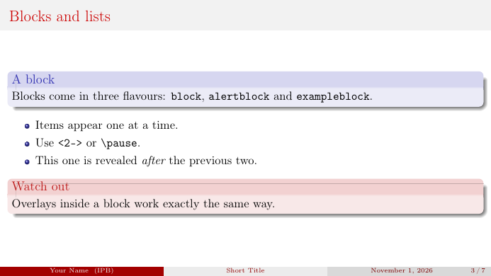

# Abisha — a beamer theme

A small Beamer theme for lectures and talks. It builds on `Boadilla`'s layout
and the `beaver` palette: serif body text, justified paragraphs, no navigation
symbols, and a footer carrying the author, short title and frame number.



## Requirements

- A TeX distribution with `beamer`, `tikz` and `ragged2e` (TeX Live, MiKTeX,
  MacTeX — all of them ship these).
- `latexmk`, which comes with all of the above.

## Quick start

The fastest route is **Use this template** on GitHub, which gives you a fresh
copy without this repository's history. Or clone it:

```powershell
git clone https://github.com/nicabisha/beamer-template.git my-talk
cd my-talk
latexmk main.tex        # -> build/main.pdf
```

Then edit the metadata block at the top of `main.tex`:

```latex
\documentclass[aspectratio=169]{beamer}
\usetheme{Abisha}

\title[Short Title]{Your Talk Title}
\subtitle{A subtitle, if you want one}
\author[Your Name]{Your Name}
\institute[IPB]{Program Studi Matematika\\ IPB University}
\date{\today}

\abishalogo{images/logo_ipb.png}   % optional; skipped with a warning if absent
```

Everything else in `main.tex` is an example — delete what you do not need.

## Using the theme in another project

Only `beamerthemeAbisha.sty` is needed. Copy it next to your `.tex` file, or put
it anywhere on `TEXINPUTS`:

```powershell
$env:TEXINPUTS = "D:\path\to\beamer-template;" + $env:TEXINPUTS
```

### Theme options

| Option               | Effect                                                                       |
| -------------------- | ---------------------------------------------------------------------------- |
| *(none)*             | Default look, including the footer inherited from `Boadilla`.                 |
| `nofootline`         | Removes the footer. Buys vertical space on very dense slides.                 |

### Logo

```latex
\abishalogo{images/logo.png}         % default width 1.6cm
\abishalogo[2.2cm]{images/logo.png}
```

The path is looked up at compile time, so a copy of the template without a logo
still compiles — you get a warning instead of an error.

### Justified text

The theme calls `\justifying` from `ragged2e` at load time. Add `\raggedright`
to a frame (or your preamble) if you would rather have ragged-right text.

### Blocks

The three block kinds have distinct, theme-matched tints:

| Environment       | Colour |
| ----------------- | ------ |
| `block`           | muted plum |
| `exampleblock`    | green |
| `alertblock`      | red |

Recolour any of them from your preamble, e.g.
`\setbeamercolor{block title}{fg=...,bg=...}`.

## Repository layout

```
beamerthemeAbisha.sty      the theme itself
main.tex                   starter deck — edit this
images/logo_ipb.png        title-page logo (\abishalogo)
examples/akm-pekan6.tex    a real 24-page lecture deck using the theme
preview.png                screenshot used by this README
.latexmkrc                 puts all build products in build/
.github/workflows/build.yml  compiles both decks on every push
```

## The example deck

`examples/akm-pekan6.tex` is a full lecture deck kept in the repository as a
stress test: TikZ diagrams, `booktabs` tables, `listings` code and dense
multi-column layouts. It proves the theme survives real content.

Two things to know about it:

- **Images.** The photographs from the original lecture (MNIST digits, face
  photos) are not distributed here. `\exampleimage` draws a correctly sized
  placeholder when the file is missing; drop the real files into `images/`
  under the same names and they appear automatically.
- **Language.** It uses Indonesian through `\babelprovide[main, import]{indonesian}`
  rather than the class option `bahasa`, which babel removed in 26.13.

```powershell
latexmk examples/akm-pekan6.tex    # -> build/akm-pekan6.pdf
```

## Continuous integration

`.github/workflows/build.yml` compiles `main.tex` and the example deck on every
push and pull request with
[`xu-cheng/latex-action`](https://github.com/xu-cheng/latex-action), and uploads
both PDFs as build artifacts. A broken theme shows up as a red check instead of
a broken lecture.

## License

This work may be distributed and/or modified under the conditions of the
LaTeX Project Public License, either version 1.3c of this license or (at your
option) any later version. See [LICENSE](LICENSE).
